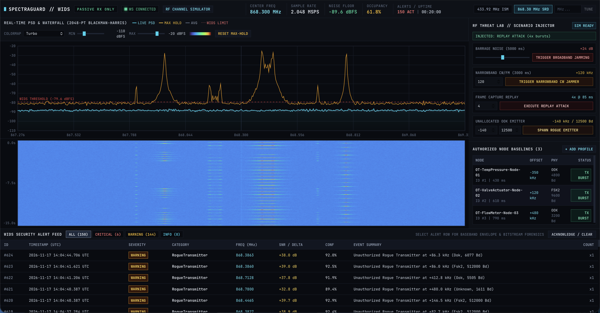
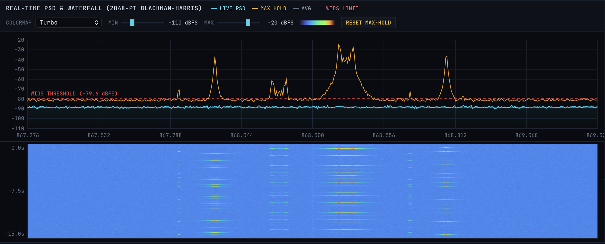
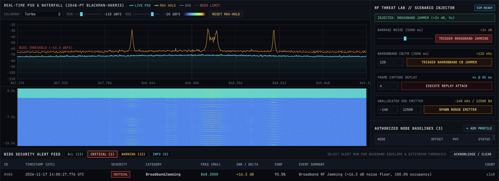
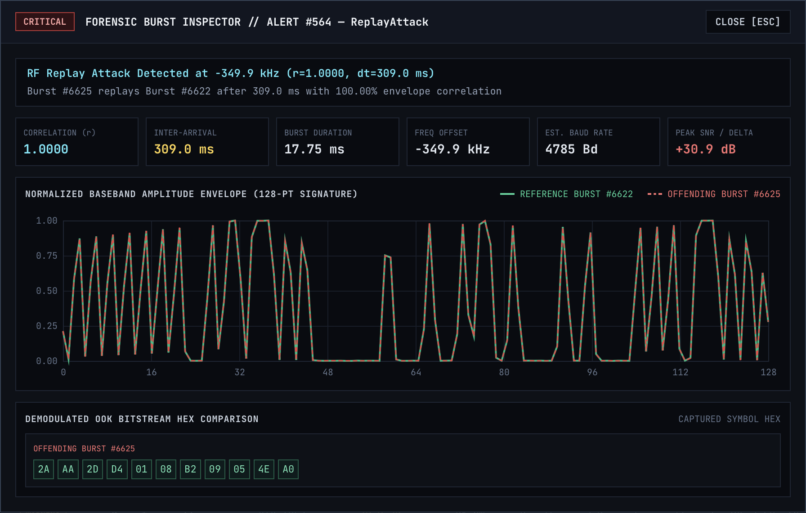
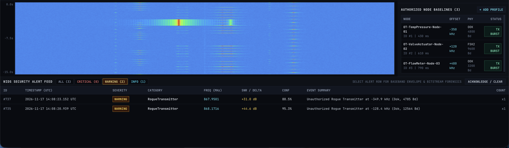
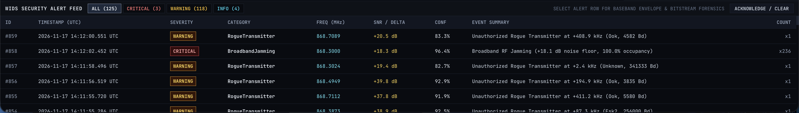
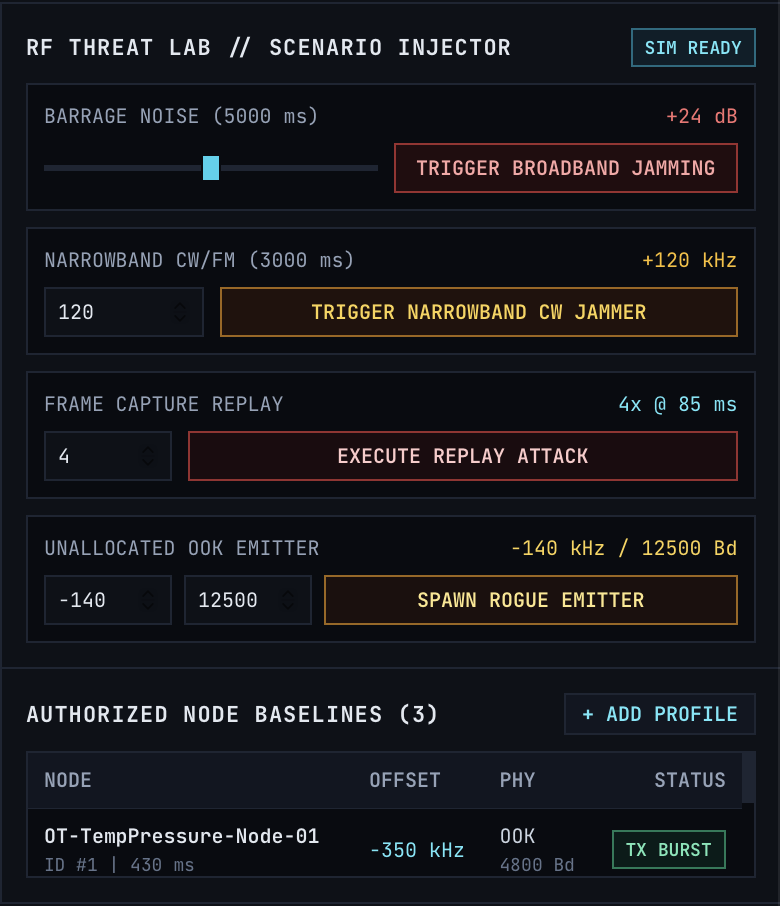
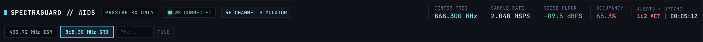
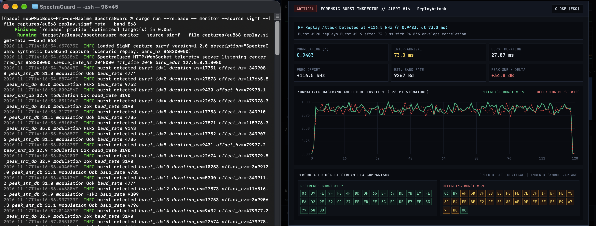

<p align="center">
  
</p>

<h1 align="center">SpectraGuard</h1>

<p align="center">
  <b>Watch the radio spectrum of your industrial telemetry links, passively</b><br>
  a receive-only wireless intrusion detection system for 433.92 MHz and 868.30 MHz, with a live waterfall, alerts and forensic captures in one place.
</p>

<p align="center">
  <a href="LICENSE"></a>
  
  
  
  
  
</p>

<p align="center">
  <a href="#quickstart">Quickstart</a> ·
  <a href="#features">Features</a> ·
  <a href="#detection-methodology-and-thresholds">Detection</a> ·
  <a href="#legal-notice-and-responsible-use">Legal notice</a> ·
  <a href="#license">License</a>
</p>

<p align="center">
  
</p>

SpectraGuard is a single Rust binary with an embedded web interface. It reads complex baseband IQ from
a simulator or from SigMF captures, runs a spectral and burst pipeline on it, and raises alerts when the
band stops behaving like your installation. It never transmits: there is no TX driver, no modulator
output and no countermeasure in the code. Read the [legal notice](#legal-notice-and-responsible-use)
before pointing it at anything real.

New here? Run `make demo-868`, open `http://127.0.0.1:8080`, and use the **Threat Lab** panel to inject
a simulated jammer, replay or rogue node. Nothing is emitted over the air; the threats are synthesized
inside the simulator.

## Why it exists

Industrial and critical-infrastructure sites rely on license-exempt Sub-GHz bands, **433.92 MHz (EU ISM)**
and **868.30 MHz (EU SRD860)**, for pressure and temperature sensors, flow meters, valve actuators and
SCADA or PLC telemetry. Many of these links use unencrypted or statically keyed OOK or 2-FSK framing and
have no intrusion telemetry above the physical layer. That leaves them exposed to RF denial of service,
capture-and-replay injection and unauthorized transmitters. SpectraGuard is an out-of-band sensor that
watches the physical layer for exactly those three things.

## Features

### The whole band in one window

A 2048-point Blackman-Harris FFT feeds a live spectrum trace and a scrolling waterfall drawn on a canvas.
Each burst is extracted with its carrier offset, modulation, baud rate and duration, and the band can be
switched between 433.92 MHz and 868.30 MHz without restarting. The decimated power spectral density is
streamed to the browser at 25 frames per second.



### Jamming detection

The noise floor is estimated from a low-quartile order statistic, so narrowband telemetry bursts do not
bias it, and compared with a slow baseline. Barrage jamming and narrowband continuous-carrier jamming are
reported separately, each with its own severity.



### Replay detection

Every burst envelope is resampled to a 128-point signature and compared with recent bursts of similar
offset and duration using Pearson correlation. A near-identical envelope that breaks the expected
cadence, or carries the same demodulated frame, is flagged as a replay. The **Forensic Inspector** lays
the two envelopes over each other.



### Rogue transmitter profiling

You declare the field nodes you trust as device baselines: carrier offset, modulation, baud rate and
duration bounds. Any modulated burst that matches none of them raises a rogue transmitter alert. Baselines
are managed from the interface or the REST API.



<details>
<summary>Alert feed, Threat Lab and other views</summary>





</details>

### Forensic capture in SigMF

Record IQ to the standard Signal Metadata Format (`.sigmf-meta` plus `.sigmf-data`) with ground-truth
threat annotations, and replay any capture through the same DSP and WIDS engine and the same interface.
`cf32_le`, `ci16_le` and `cu8` are supported, with no extra dependency.



### Telemetry and control API

An Axum server exposes a JSON WebSocket for live telemetry and a small REST API for status, band
selection, alerts, baselines and simulator injection. The web interface is embedded in the binary.

| Endpoint | Method | Purpose |
| :--- | :--- | :--- |
| `/ws/telemetry` | WebSocket | Decimated PSD frames and alert events |
| `/api/v1/status` | GET | Pipeline and source status |
| `/api/v1/config/band` | POST | Switch the monitored band |
| `/api/v1/spectrum/reset-hold` | POST | Reset the peak-hold trace |
| `/api/v1/sim/inject` | POST | Inject a simulated threat (simulator source only) |
| `/api/v1/alerts` | GET | List alerts |
| `/api/v1/alerts/clear` | POST | Clear alerts |
| `/api/v1/baselines` | GET, POST | Read or register authorized device baselines |

## System architecture

```text
+-----------------------------------+
|             RfSource              |
|        [ RF Simulator | SigMF ]   |
+-----------------+-----------------+
                  | Complex Baseband IQ (cf32_le, 2.048 MSPS)
                  v
+-----------------------------------+
|   DSP Spectral & Burst Pipeline   |
|  - 2048-pt Blackman-Harris FFT    |
|  - Ordered-Stats Noise Floor      |
|  - Envelope & Baud Extractor      |
+-----------------+-----------------+
                  | SpectrumFrame + Vec<DetectedBurst>
                  v
+-----------------------------------+
|        WIDS Anomaly Engine        |
|  - EMA Baseline Drift Tracker     |
|  - Pearson Envelope Correlator    |
|  - PHY Profile Allowlist Matcher  |
+-----------------+-----------------+
                  | Decimated PSD (25 FPS) + WidsAlert Events
                  v
+-----------------------------------+
|    Axum Telemetry & Control API   |
|  - GET  /ws/telemetry (JSON WS)   |
|  - REST /api/v1/{status,config,   |
|         sim/inject,alerts,        |
|         baselines}                |
|  - Embedded Canvas Waterfall UI   |
+-----------------------------------+
```

## Quickstart

### Prerequisites

- Rust toolchain (stable, recent; 1.85 or newer is a safe choice)
- Node.js 20 or newer and `npm`, to build the embedded web interface

### Build and run

```sh
make build        # builds ui/dist, then the release binary
make demo-868     # simulator on EU 868.30 MHz, UI at http://127.0.0.1:8080
make demo-433     # simulator on EU 433.92 MHz
```

The server binds to loopback (`127.0.0.1`) by default. Keep it that way unless you add your own
authentication in front of it: the API has none.

### SigMF generation and offline playback

```sh
make gen-samples  # writes annotated clean, jamming, replay and rogue captures to captures/

cargo run --release -- monitor --source sigmf --file captures/eu868_replay.sigmf-meta --band 868
```

### Tests

```sh
make test
```

## Detection methodology and thresholds

1. **Ordered-statistics noise floor**
   - Each IQ block is windowed with a 4-term Blackman-Harris window ($N_{\text{FFT}} = 2048$, 50% overlap)
     and converted to calibrated $\text{dBFS}$ power spectral density bins.
   - Bins are sorted ascending ($P_{(0)} \le P_{(1)} \le \dots \le P_{(N-1)}$) and the instantaneous
     noise floor $N_t$ is taken from the lower-quartile ordered statistic, so narrowband bursts do not
     bias the estimate.

2. **EMA baseline drift and broadband jamming**
   - Under nominal channel occupancy ($< 30\%$), the long-term baseline $B_t$ is updated by an
     exponential moving average ($\alpha = 0.02$):
     $$B_t = \alpha N_t + (1 - \alpha) B_{t-1}$$
   - **Broadband jamming (`CRITICAL`)** triggers when $\Delta N = N_t - B_t \ge 10.0\text{ dB}$ and the
     effective channel occupancy stays $\ge 65\%$ for $\ge 250\text{ ms}$.

3. **Narrowband CW/FM jamming**
   - **Narrowband jamming (`WARNING`)** triggers when an unmodulated continuous carrier persists for
     $\ge 250\text{ ms}$ with a peak $\text{SNR} \ge 18.0\text{ dB}$.

4. **Normalized envelope cross-correlation (replay)**
   - Each burst envelope is resampled to a normalized 128-point signature $\mathbf{x} \in [0, 1]^{128}$.
   - Candidates within $\pm 15\text{ kHz}$ center offset, $\le 18\%$ duration delta and $< 5.0\text{ s}$
     inter-arrival time are compared with the Pearson coefficient:
     $$r(\mathbf{x}, \mathbf{y}) = \frac{\sum_{i=1}^{128} (x_i - \bar{x})(y_i - \bar{y})}{\sqrt{\sum_{i=1}^{128} (x_i - \bar{x})^2 \sum_{i=1}^{128} (y_i - \bar{y})^2}}$$
   - **Replay attack (`CRITICAL`)** triggers when $r(\mathbf{x}, \mathbf{y}) \ge 0.93$ together with an
     inter-arrival cadence violation or an identical demodulated bitstream.

5. **Authorized baseline allowlist and duty-cycle monitoring**
   - **Rogue transmitter (`WARNING`)** triggers when a modulated burst fails carrier offset
     ($\pm 15\text{ to }18\text{ kHz}$), modulation (`OOK` or `2-FSK`), baud rate ($\pm 35\%$) or duration
     bounds across every registered `DeviceBaselineProfile`.
   - **Duty-cycle anomaly (`INFO`)** triggers when aggregate sub-band airtime exceeds $22.0\%$ over a
     $10\text{ s}$ sliding window.

## Signal sources

| Source | CLI flag | Status | Capabilities |
| :--- | :--- | :--- | :--- |
| RF channel simulator | `--source sim` | Available | Multi-node OOK and 2-FSK synthesis, AWGN, simulated threat injection |
| SigMF file playback | `--source sigmf` | Available | `cf32_le`, `ci16_le` and `cu8` playback and generation |
| SoapySDR receivers (RTL-SDR, HackRF One in RX, LimeSDR, USRP in RX) | `--source soapysdr` | Planned | Passive Sub-GHz reception through `libsoapysdr`; the `hardware` Cargo feature is reserved for it |

Only receive paths are, and will be, supported. Pull requests that add transmission are out of scope.

## Legal notice and responsible use

SpectraGuard is a **passive, receive-only** spectrum monitor and a **local baseband simulator**. It has no
RF transmission code. This section is a plain-language summary and **not legal advice**; rules differ per
country, and you are responsible for yours.

**You may**

- Run the simulator and the SigMF playback; they involve no radio at all.
- Monitor the radio links of an installation that you own, or on which you hold the written authorization
  of the owner or operator, to detect interference, replay and unknown transmitters.
- Use synthetic captures or captures that you recorded yourself on your own equipment for tests, research
  and teaching, ideally in a shielded or lab setting.
- Read, modify and redistribute the source code under the terms of the GPLv3.

**You must not**

- Intercept, record, decode, keep or disclose the content of communications that are addressed to other
  people, or that you have no right to access. Many countries criminalize this, for example France under
  article 226-15 of the Code pénal, and the devices designed for it can themselves require a prior
  authorization.
- Transmit anything with this project: no jamming, no replay of captured frames, no spoofed nodes, no
  injection into a real network. Jamming and unauthorized transmission are illegal in most jurisdictions,
  and sending frames to equipment that you do not own can also be an unauthorized access offence.
- Use the Threat Lab or generated captures to attack, test or disturb systems that you do not own or are not
  explicitly authorized to assess. The Threat Lab only synthesizes signals inside the program.
- Process radio data that identifies or tracks people, such as key fobs, alarms or personal sensors on
  433 MHz, without a legal basis. Such captures can contain personal data subject to data-protection law
  (GDPR in the EU).
- Remove or alter this notice and the license terms when you redistribute the software.

**Regulation of the bands themselves.** Receiving does not make you a licensee, but if you pair the tool
with a hardware receiver you must still comply with the spectrum-monitoring rules of your jurisdiction
(ITU Radio Regulations, ETSI EN 300 220 in Europe, FCC Part 15 in the United States). For authoritative
answers, ask your national regulator or a qualified lawyer before deploying in the field.

The GPLv3 grants you software freedoms. It does not give you any right to use the program in a way the law
forbids, and, as stated in its sections 15 and 16, the program comes with no warranty and its authors are
not liable for how it is used.

## Repository layout

| Path | Contents |
| :--- | :--- |
| `src/sdr/` | Signal sources: simulator and SigMF reader and writer |
| `src/dsp/` | FFT spectrum, noise floor, burst detection and envelope extraction |
| `src/ids/` | WIDS engine and detection rules |
| `src/api/` | Axum REST and WebSocket server, embedded UI assets |
| `ui/` | React and Canvas interface (Vite, Tailwind) |
| `tests/` | End-to-end pipeline tests |

## Contributing

Issues and pull requests are welcome. Keep changes receive-only, add or update tests (`make test`), and
describe which detection threshold or behavior is affected. Report security problems privately to the
maintainer instead of opening a public issue.

## License

SpectraGuard is free software under the [GNU General Public License v3.0](LICENSE). You can use, study,
change and share it; if you distribute a modified version, you must publish its source under the same
license. The software is provided without warranty of any kind.